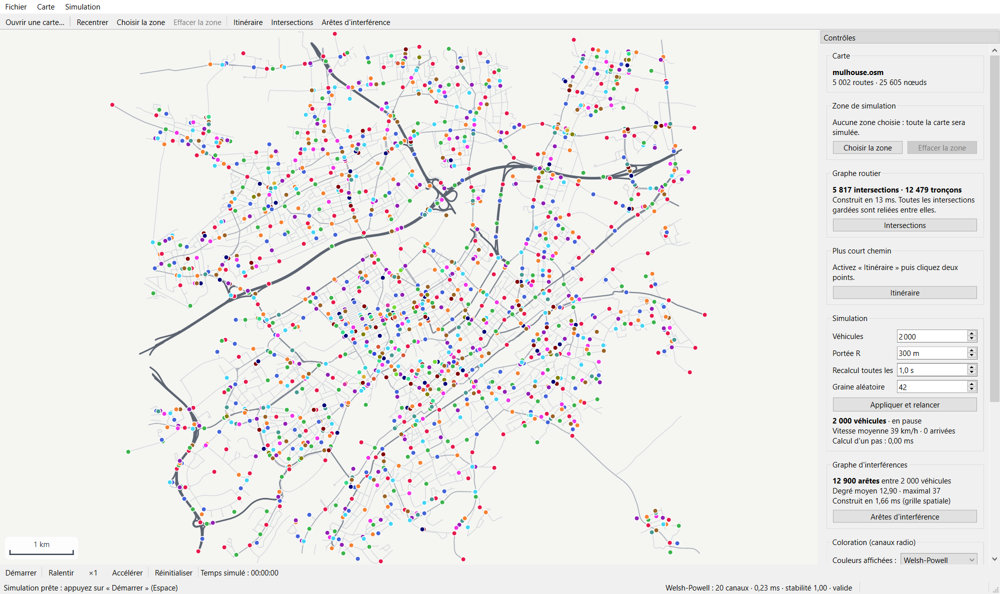

# Manuel utilisateur et développeur — Simulateur V2V

Projet de Master 1 Informatique et Mobilité, UE Réseaux Mobiles, Université de Haute-Alsace (automne 2026).

**Sommaire**

1. [Présentation](#1-présentation)
2. [Prérequis, outils et bibliothèques](#2-prérequis-outils-et-bibliothèques)
3. [Installation et lancement](#3-installation-et-lancement)
4. [Utilisation](#4-utilisation)
5. [Architecture du code](#5-architecture-du-code)
6. [Algorithmes](#6-algorithmes)
7. [Tests et performances](#7-tests-et-performances)
8. [Guide du développeur](#8-guide-du-développeur)
9. [Limites connues](#9-limites-connues)

---

## 1. Présentation

Les véhicules connectés communiquent directement entre eux (V2V). Quand beaucoup de véhicules sont proches,
leurs émissions radio se gênent s'ils utilisent le même canal. Le simulateur :

1. charge le réseau routier réel d'une ville (Mulhouse) depuis OpenStreetMap ;
2. en fait un graphe orienté (intersections, tronçons, sens uniques, longueurs) ;
3. fait rouler au moins 2000 véhicules, chacun vers une destination par le plus court chemin ;
4. construit régulièrement le **graphe d'interférences** : un sommet par véhicule, une arête entre deux
   véhicules plus proches que leur portée radio ;
5. attribue un canal à chaque véhicule par **coloration** de ce graphe (deux voisins = deux canaux différents)
   et compare quatre algorithmes : nombre de canaux, temps de calcul, stabilité dans le temps.



## 2. Prérequis, outils et bibliothèques

| Élément | Version utilisée | Rôle |
|---|---|---|
| C++ | C++17 | langage du projet |
| Compilateur | MinGW 13.1 (Windows) ; GCC, Clang ou MSVC conviennent | compilation |
| CMake | 3.20 ou plus (3.16 suffit pour compiler ; `ctest --test-dir` demande 3.20) | description de la compilation (`CMakeLists.txt`) |
| Ninja | 1.12 (facultatif) | compilation rapide |
| Qt 6 | 6.8.3 | Widgets (interface, `QGraphicsView` pour la carte), Charts (courbes), Xml (`QXmlStreamReader` pour le `.osm`) |
| Bibliothèque standard C++ | — | conteneurs, algorithmes, générateur aléatoire `std::mt19937` |
| OpenStreetMap / Overpass API | — | données cartographiques (`data/telecharger_carte.py`) |
| Git + GitHub | — | gestion du code |
| Qt Creator ou VS Code | — | éditeurs utilisés par l'équipe |

Machine : tout PC récent (le dessin se fait sur le processeur, sans carte graphique particulière). Mesuré sur un
portable Windows 10 (écran à 125 %) : 2000 véhicules à 25 images/s avec les arêtes affichées.

## 3. Installation et lancement

### 3.1 Installer Qt (Windows)

Avec l'installateur officiel de Qt : cocher **Qt 6.8 > MinGW 64-bit**, **Qt Charts**, et dans *Developer and
Designer Tools* : **MinGW 13.1**, **CMake**, **Ninja**.

Ou sans compte, en ligne de commande (Python requis), dans `C:\Qt` :

```bash
pip install aqtinstall
python -m aqt install-qt windows desktop 6.8.3 win64_mingw -m qtcharts -O C:\Qt
python -m aqt install-tool windows desktop tools_mingw1310 -O C:\Qt
python -m aqt install-tool windows desktop tools_cmake -O C:\Qt
python -m aqt install-tool windows desktop tools_ninja -O C:\Qt
```

### 3.2 Compiler

Dans PowerShell, à la racine du projet :

```bash
$env:PATH = "C:\Qt\Tools\mingw1310_64\bin;C:\Qt\Tools\CMake_64\bin;C:\Qt\Tools\Ninja;C:\Qt\6.8.3\mingw_64\bin;$env:PATH"
cmake -S . -B build -G Ninja -DCMAKE_PREFIX_PATH=C:/Qt/6.8.3/mingw_64 -DCMAKE_BUILD_TYPE=Release
cmake --build build
```

La première ligne place les outils de Qt **avant** un éventuel autre compilateur (par exemple celui de
Code::Blocks), trop ancien pour Qt 6. Elle est à refaire dans chaque nouveau terminal.

Linux / macOS : installer Qt 6 (paquet de la distribution, Homebrew ou installateur Qt) puis
`cmake -S . -B build -DCMAKE_PREFIX_PATH=<dossier de Qt 6>` et `cmake --build build`.

Avec Qt Creator : *Fichier > Ouvrir un fichier ou projet* > `CMakeLists.txt`, choisir le kit Qt 6.8 MinGW.

### 3.3 Lancer

```bash
build\v2v-simulator.exe
```

- Sans argument, la carte `data/mulhouse.osm` du projet s'ouvre automatiquement.
- Avec un argument, le fichier donné est ouvert : `v2v-simulator autre_ville.osm`.
- Pour un lancement par double-clic sous Windows, copier une fois les bibliothèques de Qt à côté de l'exécutable :
  `C:\Qt\6.8.3\mingw_64\bin\windeployqt.exe --release build\v2v-simulator.exe`.

### 3.4 Changer de carte

`data/telecharger_carte.py` télécharge les routes d'une zone par l'API Overpass (Python, sans dépendance).
Modifier `ZONE = (sud, ouest, nord, est)` en degrés pour une autre ville. On peut aussi exporter une zone depuis
openstreetmap.org (*Exporter*) : le lecteur ignore tout ce qui n'est pas une route carrossable.

## 4. Utilisation

### 4.1 La fenêtre principale


| Zone | Contenu |
|---|---|
| Centre | la carte : routes (gris, plus foncé = plus importante), véhicules (pastille de la couleur de leur canal), arêtes d'interférence |
| Haut | barre d'outils avec icônes : ouvrir une carte, recentrer, zone, effacer la zone, itinéraire, intersections, arêtes, comparaison |
| Droite | panneau de contrôle en 3 onglets : **Simulation** (réglages, état, graphe d'interférences), **Coloration** (tableau des 4 algorithmes, canaux utilisés, comparaison, export), **Carte** (carte chargée, zone, graphe routier, plus court chemin, légende des routes) ; en dessous, les gestes de souris |
| Bas | barre de contrôle du temps : démarrer/pause, ralentir, vitesse (×1...), accélérer, réinitialiser, temps simulé, images par seconde |
| Barre d'état | messages, indicateurs de la coloration affichée (canaux, temps, stabilité, validité), coordonnées GPS sous la souris |

Dans l'onglet *Coloration*, le tableau donne pour
chaque algorithme le nombre de canaux, le temps de calcul, la stabilité et la validité (✓ / ✗) ; le plus petit
nombre de canaux est en gras, et cliquer une ligne affiche les couleurs de cet algorithme sur la carte.
*Affichage > Thème sombre* (**Ctrl+T**) passe l'interface en couleurs sombres ; la carte garde ses couleurs,
choisies pour que les canaux restent lisibles.

### 4.2 Se déplacer sur la carte

- **Molette** : zoom centré sur la souris (de « toute la ville » à 20 pixels par mètre).
- **Clic-glisser** : déplacer la carte.
- **R** ou *Recentrer* : revenir à la vue de toute la carte.
- L'échelle en bas à gauche s'adapte au zoom.

### 4.3 Choisir la zone de simulation (étape 1)

1. **Z** ou *Choisir la zone*, puis clic-glisser un rectangle sur la carte (Échap pour annuler).
2. L'extérieur est assombri ; le panneau indique la taille de la zone et le nombre de routes concernées.
3. Le graphe routier est reconstruit sur la zone et la simulation relancée sur ce graphe.
4. **Suppr** ou *Effacer la zone* : revenir à toute la carte.

### 4.4 Graphe routier et plus court chemin (étape 2)

- Le panneau *Graphe routier* indique le nombre d'intersections et de tronçons (Mulhouse : 5 817 et 12 479).
- **G** ou *Intersections* : affiche les sommets du graphe.
- **I** ou *Itinéraire* : cliquer un départ (A) puis une arrivée (B). Le plus court chemin s'affiche en violet ;
  le panneau donne sa longueur et compare A* et Dijkstra (même longueur, A* visite moins d'intersections).

### 4.5 Simulation (étape 3)

| Commande | Raccourci | Effet |
|---|---|---|
| Démarrer / Pause | Espace | lance ou suspend la simulation |
| Ralentir / Accélérer | - / + | vitesse du temps simulé de ×0,25 à ×32 |
| Réinitialiser | Ctrl+R | retour à t = 0 avec le même scénario (même graine) |

Réglages du panneau *Simulation* :

| Réglage | Défaut | Application |
|---|---|---|
| Véhicules | 2000 | bouton *Appliquer et relancer* |
| Portée R | 300 m | immédiate (même en pause) |
| Recalcul toutes les | 1,0 s simulée | immédiate |
| Graine aléatoire | 42 | bouton *Appliquer et relancer* |

Chaque véhicule a une position, une vitesse (90 km/h sur autoroute, 50 sur les routes principales et
secondaires, 30 dans les rues, multipliée par un facteur propre au véhicule entre 0,8 et 1,2), une direction, une
destination et une portée radio. À l'arrivée, il reçoit une nouvelle destination au hasard.

### 4.6 Graphe d'interférences (étape 4)

- Recalculé à intervalle régulier (réglage *Recalcul toutes les*), pas à chaque image.
- **E** ou *Arêtes d'interférence* : dessine les arêtes entre véhicules en interférence.
- Le panneau donne le nombre d'arêtes, le degré moyen et maximal, et le temps de construction.

### 4.7 Coloration et comparaison (étape 5)

- À chaque recalcul, les **quatre** algorithmes colorent le même graphe. *Couleurs affichées* choisit celui
  dont les couleurs apparaissent sur la carte (et dans la barre d'état).
- Le panneau *Coloration* donne pour chacun : nombre de canaux, temps, stabilité, validité (vérifiée
  automatiquement : « valide » = aucune arête entre deux véhicules de même canal).
- La rangée de pastilles montre les canaux utilisés.
- *Comparaison…* (ou menu *Simulation*) ouvre la fenêtre de comparaison : tableau des moyennes et maximums,
  courbes k(t), temps de calcul et S(t).


### 4.8 Export CSV

*Exporter CSV…* (panneau, fenêtre de comparaison ou menu *Simulation*) enregistre une ligne par recalcul :

```
temps_s;vehicules;aretes;degre_moyen;degre_max;interference_ms;
glouton_k;glouton_ms;glouton_stabilite;glouton_valide;welsh_powell_k;...;recherche_locale_valide
```

Format français : `;` entre colonnes, virgule décimale (ouverture directe dans Excel ou LibreOffice).
En Python : `pandas.read_csv("mesures.csv", sep=";", decimal=",")`.

### 4.9 Raccourcis clavier

| Touche | Action | Touche | Action |
|---|---|---|---|
| Ctrl+O | ouvrir une carte | Espace | démarrer / pause |
| R | recentrer | + / - | accélérer / ralentir |
| Z | choisir la zone | Ctrl+R | réinitialiser |
| Suppr | effacer la zone | E | arêtes d'interférence |
| I | itinéraire | G | intersections |
| Échap | annuler le tracé de zone | Ctrl+T | thème sombre |

## 5. Architecture du code

### 5.1 Modules

Le code suit les cinq étapes du sujet ; chaque module est une petite bibliothèque CMake, testée seule.

| Module (dossier) | Bibliothèque | Classes / fonctions principales | Dépend de |
|---|---|---|---|
| Carte (`src/map`) | `v2v-carte` | `OsmLoader::charger`, `OsmCarte`, `OsmRoute`, `OsmNoeud` | Qt Core, Xml |
| Graphe routier (`src/roadgraph`) | `v2v-graphe` | `GrapheRoutier`, `Sommet`, `Troncon`, `distanceHaversine` | carte |
| Simulation (`src/simulation`) | `v2v-simulation` | `Simulation`, `Vehicule`, `ParametresSimulation` | graphe routier |
| Interférences (`src/interference`) | `v2v-interference` | `GrapheInterference`, `StatsInterference` | Qt Core |
| Coloration (`src/coloring`) | `v2v-coloration` | `Coloration::colorer`, `estValide`, `stabilite` | Qt Core |
| Interface (`src/ui`, `src/map/MapView`) | application | `MainWindow`, `MoteurSimulation`, `FenetreComparaison`, `MapView`, `Theme` | tous, Qt Widgets, Charts |

Les modules de calcul n'utilisent pas Qt Widgets : ils peuvent tourner sans interface (tests, outil d'étude).

### 5.2 Fils d'exécution

Le cahier des charges demande que la simulation et la coloration soient séparées de l'affichage.

```
 Fil de l'interface (MainWindow)                 Fil de simulation (MoteurSimulation)
 ──────────────────────────────                 ─────────────────────────────────────
 boutons, réglages ──── invokeMethod ─────────► demarrer / setEnMarche / setRayon...
                       (file d'attente)          toutes les 40 ms :
                                                   Simulation::avancer(0,04 s × facteur)
                                                   chaque seconde simulée :
                                                     GrapheInterference::construire
                                                     4 × Coloration::colorer
 MapView::afficherVehicules ◄── signal ─────────  nouvelInstantane (positions, couleurs, arêtes)
 FenetreComparaison         ◄── signal ─────────  nouvelleMesure (k, temps, stabilité...)
```

- Le moteur travaille sur **sa propre copie** du graphe routier : aucune donnée n'est partagée entre les deux fils.
- **Contre-pression** : tant que l'interface n'a pas dessiné l'image précédente, le moteur n'en envoie pas d'autre
  (sinon les images s'accumuleraient en mémoire si l'affichage prenait du retard).
- **Numéro de génération** : chaque (re)démarrage reçoit un nouveau numéro ; les messages d'une ancienne
  simulation encore en route sont reconnus et ignorés.
- Pas de temps **fixe** (0,04 s × facteur) : la simulation est reproductible quelle que soit la machine.

### 5.3 Affichage de la carte

`MapView` (une `QGraphicsView`) dessine tout en **mètres** (projection équirectangulaire autour du centre de la
carte, `OsmCarte::versMetres`). Pour rester fluide :

- toutes les routes sont **un seul objet graphique** (`CoucheRoutes`) avec un cache image : ~3 ms par image
  au lieu de ~700 ms avec un grand chemin unique ;
- tous les véhicules et arêtes sont **un seul objet** (`CoucheVehicules`) ; chaque véhicule est la copie d'une
  petite image de pastille préparée une fois par couleur : ~1 ms pour 2000 véhicules au lieu de ~20 ms ;
- seuls les éléments visibles à l'écran sont dessinés.

## 6. Algorithmes

### 6.1 Lecture de la carte

`QXmlStreamReader` lit le fichier en un passage. Sont gardées les voies `highway` = motorway, trunk, primary,
secondary, tertiary (et leurs bretelles `_link`), unclassified, residential, living_street ; sont exclues les voies
`access=no/private` et `area=yes`. Le tag `oneway` donne le sens (`-1` : la liste des nœuds est inversée) ;
autoroutes et ronds-points sont à sens unique par défaut. Mulhouse : 5 002 routes, 25 605 nœuds, ~120 ms.

### 6.2 Graphe routier

- Un nœud devient sommet s'il est partagé par plusieurs routes ou s'il termine une route.
- Chaque route est découpée en tronçons entre sommets ; un tronçon garde tous ses points (pour le dessin et le
  déplacement) et sa longueur = somme des distances de **Haversine** entre points consécutifs.
- Double sens = deux arcs, sens unique = un arc.
- On ne garde que la **plus grande composante fortement connexe** (algorithme de Kosaraju, sans récursion) :
  depuis n'importe quelle intersection on peut atteindre toutes les autres, donc toute destination tirée au
  hasard est atteignable.
- **Dijkstra** avec tas binaire ; **A\*** ajoute la distance à vol d'oiseau jusqu'à l'arrivée (× 0,99 pour rester
  une borne inférieure malgré la projection). Mulhouse : A* ~0,10 ms par trajet contre ~0,27 ms pour Dijkstra,
  même longueur sur 500 trajets tirés au hasard.

### 6.3 Déplacement des véhicules

À chaque pas, un véhicule avance le long de la polyligne de son tronçon. En fin de tronçon, le **temps** restant
(et non la distance) est reporté sur le tronçon suivant, car la vitesse peut changer. En fin de trajet, nouvelle
destination et nouveau calcul A*. Un pas pour 2000 véhicules : ~0,25 ms.

### 6.4 Graphe d'interférences et grille spatiale

Arête entre A et B si `distance(A, B) < max(rA, rB)`. Comparer toutes les paires coûte n²/2 distances
(2 millions pour 2000 véhicules). La **grille spatiale** découpe la carte en cases de côté R (la plus grande portée) :
deux véhicules en interférence sont forcément dans la même case ou dans deux cases voisines, on ne compare donc
qu'avec les 9 cases autour. Mesuré : ~1,5 ms pour 2000 véhicules contre ~4 ms en comparant toutes les paires ;
~6 ms contre ~24 ms pour 5000.

### 6.5 Coloration

| Algorithme | Principe | Coût |
|---|---|---|
| Glouton | sommets dans l'ordre 0, 1, 2... ; chacun prend la plus petite couleur libre parmi ses voisins déjà colorés | O(n + m) |
| Welsh–Powell | idem, mais sommets triés par degré décroissant ; on remplit une couleur à la fois | O(n log n + n·k + m) |
| DSATUR (Brélaz) | on colore à chaque fois le sommet dont les voisins utilisent le plus de couleurs différentes (saturation), à égalité le plus grand degré | O((n + m) log n + n·Δ/64), Δ = degré maximal (masque de bits des couleurs voisines) |
| Recherche locale (TabuCol) | part de DSATUR (k couleurs) et cherche une coloration à k − 1 couleurs en déplaçant des sommets en conflit, avec une liste tabou qui interdit de revenir en arrière ; budget de 20 000 déplacements | borné par le budget |

- **Validité** : `Coloration::estValide` vérifie à chaque recalcul qu'aucune arête ne relie deux sommets de même
  couleur (et compte les conflits éventuels).
- **Stabilité** : `S(t) = 1 − (véhicules dont le canal a changé) / N`, entre deux recalculs du même algorithme.
- **Borne inférieure** (outil d'étude) : la taille d'une grande clique ; si k = cette taille, la coloration est optimale.

Les résultats chiffrés et leur analyse sont dans l'[étude comparative](etude.md).

## 7. Tests et performances

```bash
ctest --test-dir build --output-on-failure
```

| Test | Vérifie |
|---|---|
| `test_osm_loader` | routes gardées/exclues, sens uniques, nœuds manquants, XML invalide, fichier absent |
| `test_road_graph` | découpage, longueurs Haversine, composante fortement connexe, zone, Dijkstra = A* |
| `test_simulation` | distance parcourue = vitesse × temps, positions toujours sur une route, arrivées, reproductibilité, grands pas |
| `test_interference` | grille = toutes les paires (positions et portées aléatoires, coordonnées négatives, bords de cases) |
| `test_coloring` | graphes connus (K5, cycles pair/impair, K3,3, étoile, Petersen, couronne), biparti aléatoire (DSATUR exact), validité, stabilité, déterminisme |

Certains tests acceptent un fichier `.osm` en argument pour mesurer les performances sur la vraie carte :
`build\test_road_graph.exe data\mulhouse.osm`, `build\test_simulation.exe data\mulhouse.osm`.

Performances mesurées (Mulhouse, Release) :

| Mesure | Valeur |
|---|---|
| Chargement de la carte | ~120 ms |
| Construction du graphe routier | ~16 ms |
| Un pas de simulation, 2000 véhicules | ~0,25 ms |
| Graphe d'interférences, 2000 véhicules (grille) | ~1,5 ms |
| Coloration (Glouton / Welsh–Powell / DSATUR / recherche locale) | ~0,1 / 0,25 / 2,3 / 5,7 ms |
| Une image affichée, 2000 véhicules + arêtes | ~10 ms (25 images/s) |
| 5000 véhicules | 25 images/s (22 avec les arêtes) |

## 8. Guide du développeur

### 8.1 Conventions

- C++17, noms et commentaires **en français**, documentation des fonctions en Doxygen (`///`).
- Accolade sur la même ligne pour `if`/`for`/`while`, sur sa propre ligne pour les fonctions.
- Les modules de calcul (`map/OsmLoader`, `roadgraph`, `simulation`, `interference`, `coloring`) ne dépendent pas de
  Qt Widgets.
- Toute nouvelle fonctionnalité de calcul vient avec un test dans `tests/` (macro `CHECK`, sans framework).

### 8.2 Ajouter un algorithme de coloration

1. `src/coloring/Coloring.h` : ajouter la valeur à `enum class Algo`, augmenter `NOMBRE_ALGOS`, compléter
   `TOUS_LES_ALGOS`.
2. `src/coloring/Coloring.cpp` : compléter `nom`, `nomCourt` et `colorer`.
3. `tests/test_coloring.cpp` : l'ajouter aux graphes connus.
4. Rien d'autre : le moteur, le panneau, la fenêtre de comparaison, l'export CSV et l'outil d'étude parcourent
   `TOUS_LES_ALGOS` ; seule `FenetreComparaison::couleurAlgo` attend une couleur pour la courbe.

### 8.3 Ajouter un réglage de simulation

1. Ajouter le champ à `ParametresSimulation` (`src/simulation/Simulation.h`) et l'utiliser dans `Simulation`.
2. Ajouter le contrôle dans `MainWindow::creerPanneau` et le recopier dans `MainWindow::lancerSimulation`.

### 8.4 Outil d'étude

`build\etude_coloration.exe data\mulhouse.osm > resultats.csv` rejoue, sans interface, de nombreux scénarios
(nombre de véhicules × portée × graine) et écrit une ligne CSV par recalcul ; un résumé s'affiche à la fin.
`--rapide` pour un essai court. Voir l'[étude comparative](etude.md).

## 9. Limites connues

- Pas de simulation physique de la radio (propagation, obstacles), ni de trafic microscopique (feux, priorités,
  files d'attente) : exclus par le cahier des charges. Des véhicules peuvent donc se superposer.
- La projection équirectangulaire est précise pour une ville (erreur < 0,1 %), pas pour une région entière.
- Au-delà de 100 000 arêtes visibles, l'affichage des arêtes est tronqué (l'image serait illisible) ; les calculs
  utilisent toujours le graphe complet.
- La stabilité compare les numéros de canaux tels quels : deux colorations identiques à un renommage près des
  couleurs comptent comme différentes (c'est la définition du sujet).
